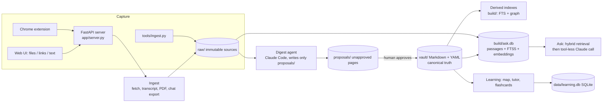

# Architecture and design decisions

## The problem

Reading is easy to do and hard to retain. Articles, videos, papers and AI chats pile up as unsearchable bookmarks, and AI summaries are untrustworthy because nothing links a claim back to evidence. This system turns reading into **structured, evidence-linked knowledge that a human approves**, then supports learning it (spaced repetition, a Socratic tutor, concept maps) and querying it (Ask).

Design goals, in priority order: **(1)** never let unreviewed AI output become "truth"; **(2)** every claim traceable to a source passage; **(3)** local and private; **(4)** simple enough to run with one command.

## Components

| Layer | Code | Responsibility |
|---|---|---|
| Parsing / schema | `tools/kb/parse.py`, `schema.py` | Markdown + YAML pages, typed relations, ids |
| Validation | `tools/kb/validate.py` | Unique ids, resolvable links, **verbatim quotes**, schema rules |
| Derived storage | `tools/kb/index.py`, `ask.py` | Rebuildable search and graph indexes (`build/`) |
| Learning | `tools/kb/learning.py`, `learnmap.py` | SM-2 scheduling, mastery, prerequisite-ordered learning map |
| Operations | `tools/kb/ops.py` | Approve / discard / diff: shared by CLI and web so they cannot diverge |
| Agent policy | `tools/kb/agent.py` | The digest agent's prompt and tool allow/deny list, plus a model of that list the red team tests against |
| Evaluation | `tools/kb/evals.py`, `digest_eval.py`, `redteam.py`, `evals/` | Retrieval metrics, groundedness checks, digest quality, prompt-injection red team |
| Metrics | `tools/kb/metrics.py` | Cost, latency and tokens per model call; approval rate per review (`./kb metrics`) |
| Integration | `tools/kb/mcp_server.py` | Read-only MCP server so other agents can query the vault with citations |
| Sandbox | `tools/kb/sandbox.py`, `demo/` | Throwaway copy of the system around a sample vault, for the demo and for live red-team runs |
| UI | `app/`, `extension/` | Thin HTTP layer and a vanilla-JS single-page app; browser clipper |

## Key decisions and trade-offs

**Files as the source of truth, databases as disposable caches.** Approved Markdown + YAML in `vault/` is canonical and Obsidian-compatible; Git gives history, diffs and rollback for free. Everything in `build/` can be deleted and rebuilt. *Cost:* no concurrent multi-user writes. *Gain:* no migrations, no lock-in, trivially backed up.

**Human approval gate.** The digest agent can write only inside `proposals/`; only a person runs approve (web Review page or `./kb approve`). *Cost:* review effort. *Gain:* an AI mistake or a poisoned web page cannot silently enter the knowledge base.

**Immutable opaque ids, relations by id.** Renaming a page never breaks links; a target without a page is written `unresolved: "Name"` instead of a guessed id.

**Evidence rules enforced by code, not by prompt.** Quotes must be verbatim from the raw file and are checked by `validate`; AI chats are never accepted as evidence; claims are tagged fact / inference / speculation.

**Hybrid retrieval for Ask.** Passages (about 900–1500 characters, split on paragraph boundaries, each with a timestamp or page locator) are indexed twice: SQLite FTS5 with BM25 (exact terms, names, numbers) and `bge-small-en-v1.5` embeddings (paraphrases). The two rankings are merged with reciprocal-rank fusion (k = 60). Approved vault pages get a small boost and are capped at half the results so raw sources are not crowded out. Semantic hits below a cosine similarity of 0.68 are discarded: real questions scored at least 0.72 and nonsense at most 0.66 on this corpus, so Ask can still answer "nothing found" instead of sending irrelevant text to the model. Measured results are in `docs/eval-results.md`. *Why embeddings run on ONNX (fastembed):* no PyTorch install, CPU-only, ~15 passages/s. *Why brute-force cosine in NumPy:* at ~10⁴ passages a matrix multiply takes milliseconds, so a vector database would add moving parts for no benefit. This would change at roughly 10⁶ passages.

**Incremental, failure-tolerant indexing.** Files are re-chunked only when their mtime or size changes; embeddings are committed in batches so searches use partial progress; if the embedding library is missing or fails, Ask silently falls back to keyword search. Writes are serialised with a lock and SQLite runs in WAL mode so the background embedder never blocks a query.

**Caching and cost control.** The query embedding and passage matrix are cached in memory (invalidated when the embedding count changes). Ask makes **one** Claude call per question and none when retrieval finds nothing. Digest jobs are serialised so several browser clips queue instead of running in parallel.

The reasoning behind the decisions that would be expensive to reverse is recorded one per page in [`docs/adr/`](adr/README.md).

## Failure handling

| Failure | Behaviour |
|---|---|
| Page cannot be downloaded (paywall, block) | The clipper sends the text the browser already rendered; otherwise the job fails with a readable message |
| Server restarts mid-job | Job history persists in `data/jobs.json`; running jobs are marked `interrupted` |
| Claude call times out or errors | HTTP 504 / 502 with a reason; nothing is written |
| Embedding model unavailable | Keyword search continues; `/api/health` shows embedded vs total passages |
| Duplicate clip | Detected by URL; reported as "already saved", nothing written |
| Bad model output (fabricated citation / quote) | Flagged by `check_answer` and returned as `problems` with the answer |

## Operations

- `./web` runs the app; `Dockerfile` + `docker-compose.yml` run it in a container with the port published on `127.0.0.1` only and your data mounted from disk.
- `./demo.sh` (or `docker compose -f docker-compose.demo.yml up`) runs the app on the sample vault in a throwaway folder.
- GitHub Actions (`.github/workflows/ci.yml`) runs the tests and the structural red-team suite on Python 3.12 and 3.14, and builds the image. Vault validation is a local check because `raw/` is private.
- Monitoring: `GET /api/health` (counts, embedding progress, running jobs) and one JSON log line per API request on stderr, with every rejected request logged at WARNING.
- Cost and review metrics: every digest and Ask call appends its cost, duration, turns and token counts to `data/metrics.jsonl`; every approve or discard appends a review decision. `./kb metrics` summarises them.

## What is deliberately not built

Multi-user accounts, a hosted deployment, a whole-vault graph view (too crowded to be useful; concept maps and the learning map replace it), a write tool on the MCP server (ADR 6), and a model judge as a gate. Deterministic checks decide what is approved; the one model judge (`digest_eval --judge`) is an optional sampled report (ADR 7).
