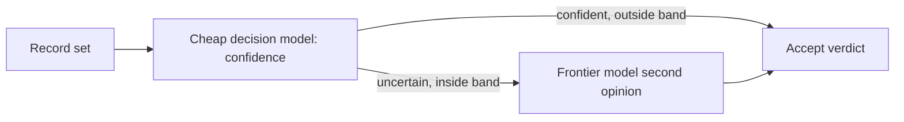

# Confidence-gated hybrid judge (cheap model, then frontier)

## Knowledge

- [fact] Hightouch tested "Jev first, then Opus" and "Luna first, then Opus" with different escalation bands (src_x1ew5c1z, "Hybrid evaluator model").
- [fact] Easier test: Jev + Opus on 30-90% confidence sent 22% of cases to Opus and reached 98.8% accuracy at $0.88 per 1,000, versus Opus alone 99.0% at $3.86. Luna + Opus on 10-90% sent 6% and reached 98.5% at $0.33.
- [fact] Harder test: Opus alone 95.1% ($5.39); Jev hybrid 95.3% ($2.94); Luna hybrid 91.6% ($1.15).

## Evidence

- [fact] Table "Harder test results" and the final comparison table in the source. See [[a-jev-then-opus-hybrid-matches-opus-accuracy-at-over-4x-lower-cost]] and [[calibration-not-out-of-box-accuracy-determines-hybrid-judge-performanc]].
- [fact] Vendor-measured, single benchmark; see source reliability.

## Understanding

- [inference] Cost scales with the share escalated, so spend rises automatically when the data are harder, provided the gate is calibrated ([[confidence-calibration]]).
- [inference] The band is the tuning knob; the authors note thresholds could be narrowed to cut cost at some accuracy loss.

## Application

- Use when a cheap scorer exists, a trustworthy expensive judge exists, and volume makes the expensive one costly (for example auditing samples of 100,000 identities).
- Not worth it if the cheap model's errors are confident, or if the expensive model is itself unreliable on the task.

## Uncertainty

- [speculation] The authors "suspect it's not just useful in this domain"; untested here. See [[does-the-hybrid-cascade-generalise-beyond-identity-resolution]].
- [inference] Band choices were picked after seeing results on the same data (risk of overfitting thresholds).

## Related

[[confidence-calibration]], [[decision-models-confidence-score-models]], [[identity-resolution-and-over-merging]], [[evaluating-llms]]
