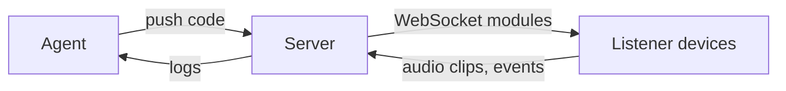

# Giving coding agents sensors and live hot-swap channels

## Knowledge
[fact] In Willison's project, Claude Code ran a web server connected over WebSockets to several listening devices, each running a WebAudio microphone and able to receive fresh JavaScript to execute (the `installModule()` method). The agent could then query audio logs and reconfigure the listeners. [fact] Opus 5.5 built this hot-swap mechanism in the first session; Fable 5.2 was then used to run and improve the system live.

## Evidence
[fact] Single source: Willison's account (source page "Locating the source of a mysterious beep with Claude", "How I built it", "Giving Claude Code ears"). The outcome was locating a beep to about 40cm. The author describes his role as mostly "chatting" and requesting features. No independent confirmation.

## Understanding
[inference] This extends the [[self-verification-loop]] idea from tests to physical sensing: give the agent an observable signal plus a way to change the instrument, and it can iterate without a human at each step. The hot-swap channel removed a human bottleneck (per-device permission prompts). [inference] The "ears" are analysis code, not model-level audio understanding.

## Application
Use when a problem needs sensing the environment from several points and the agent must iterate while the human is away. Avoid exposing a remote-code channel on untrusted networks.

## Uncertainty
[inference] Generality beyond audio is unknown (see [[how-far-can-coding-agents-perceive-and-act-on-the-physical-world]]). [speculation] Similar loops (webcam, USB serial) may work for other debugging, based on one second-hand anecdote in the source.

## Related
[[beep-locator]], [[llm-agents]], [[agent-harness]], [[claude-code-can-be-given-ears-via-browser-microphones-and-code-it-can]]
