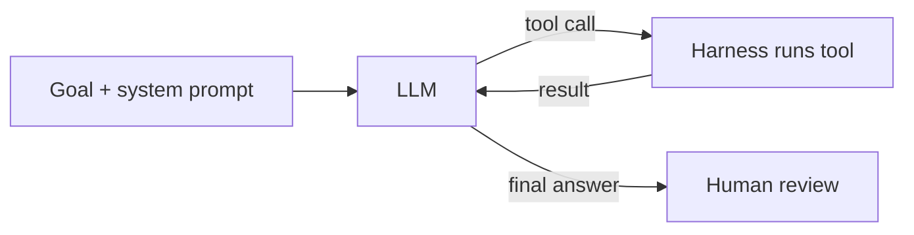

# LLM agents

## Knowledge
- An agent is software that calls an LLM with a prompt and tool definitions, runs the tools the LLM asks for, and feeds results back until a goal is met.
- Anthropic separates workflows (predefined code paths) from agents (LLM-directed). OpenAI's SDK treats agents as LLMs with instructions and tools, plus handoffs and guardrails.
- Coding agents add code execution, which lets them iterate towards software that demonstrably works.

## Evidence
- Agents run tools in a loop to achieve a goal. [fact] (Willison, What is agentic engineering?)
- Agents are systems where LLMs dynamically direct their own processes and tool usage; they are typically just LLMs using tools based on environmental feedback in a loop. [fact] (Anthropic, Building effective agents)
- OpenAI's SDK primitives: agents (LLMs with instructions and tools), agents as tools or handoffs, guardrails, plus tracing. [fact] (OpenAI Agents SDK docs; vendor source)
- Anthropic: agents need ground truth from the environment at each step and stopping conditions for control; autonomy raises costs and the risk of compounding errors. [fact] (Anthropic)
- See [[claim-agents-are-llms-using-tools-in-a-loop]].

## Understanding
- Most of an agent's apparent intelligence comes from the model; the harness decides which tools, instructions and context it gets. [inference] (see [[agent-harness]])
- Tool design is a first-class problem: Anthropic spent more time optimising tools than the overall prompt for its SWE-bench agent. [fact] (Anthropic, Appendix 2)

Follow the loop: the model requests a tool, the harness runs it and returns the result, until a final answer.

## Application
- Use agents for open-ended problems with verifiable feedback (such as coding); prefer workflows when steps are known. [inference] (see [[workflows-versus-agents]])
- Add checks, sandboxes and human review for autonomous runs. [fact] (Anthropic recommends extensive sandbox testing and guardrails)

## Uncertainty
- Definitions vary by author and vendor. [fact] (Anthropic notes several definitions)
- This page uses vendor docs and individual practitioners; no controlled studies are in `raw/`. [inference]

## Related
- [[agentic-engineering]] — doing software engineering with agents.
- [[agent-harness]] — the loop's host software.
- [[workflows-versus-agents]] — when to use agents at all.
- [[multi-agent-orchestration]] — several agents together.
- [[tool-use-and-function-calling]] — the mechanism for acting.
