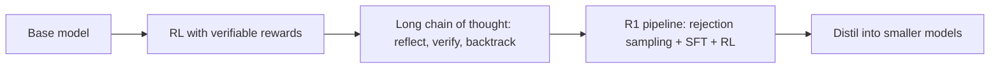

# Reasoning models and long chain-of-thought

## Knowledge
- A reasoning model writes a long chain of thought (often hundreds to thousands of tokens) before its answer, and is trained mostly with reinforcement learning on tasks whose answers can be checked. [fact] (DeepSeek-R1 paper; Karpathy lecture)
- Typical behaviours that appear in the chain: exploring alternatives, reflecting, backtracking, re-checking. [fact] (DeepSeek-R1 paper, 2.3)
- Providers expose this as a toggle or an effort/thinking setting; higher effort uses more thinking time and tokens. [fact] (Claude prompting docs; Tech With Tim)
- The DeepSeek authors report AIME 2024 pass@1 for R1-Zero rising from 15.6% to 77.9% during RL training, with response length growing steadily. [fact] (DeepSeek-R1 paper, 2.3; authors' own result)

## Evidence
- DeepSeek-R1 paper: pass@1 on AIME 2024 reached 79.8% for DeepSeek-R1; majority voting over 64 samples only moved GPT-4o from 9.3% to 13.4%; for R1, pass@64 was 90.0% and majority voting gave 86.7%. [fact] (paper p.59-60, E.4; authors' report)
- The paper's explanation: in majority voting the samples are independent, and a non-reasoning model cannot backtrack or self-correct. [fact] (paper p.60)
- Karpathy: thinking models were "tuned with reinforcement learning" and help on hard maths and code; he tries non-thinking models first because responses are quick, and switches when the answer seems weak. [fact] (Karpathy re-upload, 16:00 to 23:13)
- Claude docs: recent models use adaptive thinking driven by an effort setting; general instructions such as "think thoroughly" often beat hand-written plans; a prompt that asks for reasoning in tags may be declined on some models. [fact] (Prompting best practices; vendor docs, volatile)
- Zitron argues that token-heavy reasoning pushes inference cost up. [fact] (Zitron, opinion; see the economics claim)

## Understanding
- Reinforcement learning gives the model a reason to spend more tokens when problems are hard, because longer, self-checking chains earn more reward on verifiable answers. [inference] (from the reward design in the DeepSeek paper)
- Long chains trade latency and cost for accuracy; this is why effort levels exist. [inference]

## Application
- Use thinking mode for hard maths, code debugging and multi-step logic; skip it for simple lookups and advice. [fact] (Karpathy)
- Set effort deliberately: low for quick prototypes, higher only when correctness matters, because time and usage rise sharply. [fact] (Tech With Tim, presenter's experience)
- Do not hand-write step plans for the model; give the goal and let it plan. [fact] (Claude docs)

## Uncertainty
- Whether RL creates new reasoning ability or surfaces ability already in the base model is not settled in these sources. [speculation]
- The "aha moment" reading of R1-Zero's behaviour is disputed in the literature the paper itself cites; see the claim page. [fact]
- Model names, effort scales and prices here are volatile and dated 2026-11-08. [inference]

## Related
- [[reinforcement-learning-with-verifiable-rewards]] — how the reward is built.
- [[the-r1-zero-aha-moment-shows-reflection-emerging-from-rl]] — contested reading.
- [[reinforcement-learning-on-verifiable-rewards-alone-can-elicit-reasonin]] — the headline claim.
- [[deepseek-r1]], [[reinforcement-learning-basics]], [[supervised-fine-tuning]], [[context-window-and-compaction]]
