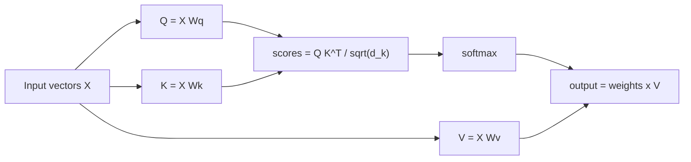

# Self-attention

## Knowledge
- Self-attention relates different positions of a single sequence to compute a representation of that sequence.
- In the Transformer, queries, keys and values all come from the previous layer. Each output is a weighted sum of the values, with weights from a softmax over scaled query-key dot products.
- Attention(Q, K, V) = softmax(QK^T / sqrt(d_k)) V.

## Evidence
- An attention function maps a query and a set of key-value pairs to an output; the output is a weighted sum of the values, with each weight from a compatibility function of the query with the key. [fact] (Vaswani 2017, §3.2)
- The paper computes dot products of the query with all keys, divides by sqrt(d_k), and applies a softmax to get weights on the values. [fact] (Vaswani 2017, §3.2.1)
- For large d_k, the authors suspect large dot products push softmax into regions with very small gradients, so they scale by 1/sqrt(d_k). [fact] (Vaswani 2017, §3.2.1 and footnote 4)
- A self-attention layer connects all positions with a constant number of sequential operations, versus O(n) for recurrent layers. [fact] (Vaswani 2017, §4, Table 1) See [[claim-self-attention-has-constant-sequential-depth]].
- Alammar's walk-through: create Query, Key and Value vectors from each embedding (64-dimensional against 512-dimensional embeddings), score by dot product, divide by 8, apply softmax, weight the values, and sum. [fact] (Alammar 2018, Self-Attention in Detail)

## Understanding
- Think of it as a soft lookup: the query asks, keys advertise, and softmax turns match scores into how much of each value to blend in. [inference] (an intuition; Alammar calls Q/K/V "abstractions that are useful for calculating and thinking about attention")
- The cost is O(n^2 d) per layer because every position scores against every other. [fact] (Vaswani 2017, Table 1)

Look at how Q and K only decide the weights, while V is what gets blended into the output.

## Application
- It is the core operation inside every Transformer layer; see [[multi-head-attention]] and [[transformer-architecture]]. [inference]
- Quadratic cost in sequence length is the main practical limit; the paper suggests restricting attention to a neighbourhood of size r as future work. [fact] (Vaswani 2017, §4)

## Uncertainty
- The authors say attention could yield more interpretable models, and that individual heads appear to learn different tasks. [fact] (Vaswani 2017, §4; the authors' own qualitative claim)
- Alammar warns: "If we add all the attention heads to the picture, however, things can be harder to interpret". [fact] (Alammar 2018)
- This page has no source on post-2017 attention variants; Alammar only mentions Multi-Query Attention and RoPE. [inference]

## Related
- [[multi-head-attention]] — several of these in parallel.
- [[positional-encoding]] — how order is supplied, since attention alone ignores order.
- [[embeddings]] — the vectors fed in.
- [[transformer-architecture]] — the full model.
