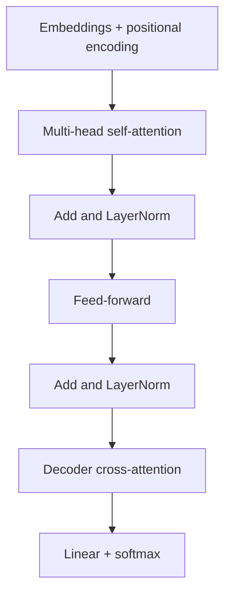

# Transformer architecture

## Knowledge
- The original Transformer is an encoder-decoder model using stacked self-attention and point-wise fully connected layers. It dispenses with recurrence and convolutions entirely.
- Encoder: N = 6 identical layers, each with multi-head self-attention then a position-wise feed-forward network. Decoder: N = 6 layers, adding attention over the encoder output and a masked self-attention.
- All sub-layers use residual connections followed by layer normalization; d_model = 512.

## Evidence
- The paper proposes a network "based solely on attention mechanisms, dispensing with recurrence and convolutions entirely". [fact] (Vaswani 2017, Abstract)
- The output of each sub-layer is LayerNorm(x + Sublayer(x)); the decoder masks self-attention to prevent attending to subsequent positions. [fact] (Vaswani 2017, §3.1)
- The feed-forward network is two linear transformations with a ReLU, d_model = 512, inner dimension 2048. [fact] (Vaswani 2017, §3.3)
- The model uses h = 8 heads. [fact] (Vaswani 2017, §3.2.2)
- Alammar: the encoders are identical in structure but do not share weights, and the same feed-forward network is applied independently to each position. [fact] (Alammar 2018, A High-Level Look; The Residuals)
- Reported results: 28.4 BLEU (EN-DE) and 41.8 BLEU (EN-FR) on WMT 2014, as the authors' own figures. [fact] (Vaswani 2017, Abstract) See [[claim-transformer-sota-translation-at-lower-cost-2017]].
- Alammar's 2025 update says later Transformer models evolved with variants such as Multi-Query Attention and RoPE. [fact] (Alammar 2018, update note)

## Understanding
- Because positions interact only inside attention, the rest of each layer parallelises across positions, which is where the training-speed gain over recurrent models comes from. [inference] (from Alammar's description and the paper's parallelisation argument)
- Residual connections let each sub-layer learn a modification of its input rather than a full transformation. [inference]

Follow one position through an encoder layer: attention, add and norm, feed-forward, add and norm.

## Application
- The pattern is the basis for modern language models, though most current LLMs use variants (for example decoder-only). [speculation] (this wiki has no source on current architectures beyond Alammar's note)

## Uncertainty
- This page describes the 2017 design; later changes (positional schemes, attention variants, decoder-only stacks) are not covered by sources in `raw/`. [inference]
- BLEU results are the authors' own and dated. [inference]

## Related
- [[self-attention]] — the central operation.
- [[multi-head-attention]] — how attention is parallelised.
- [[positional-encoding]] — how order enters the model.
